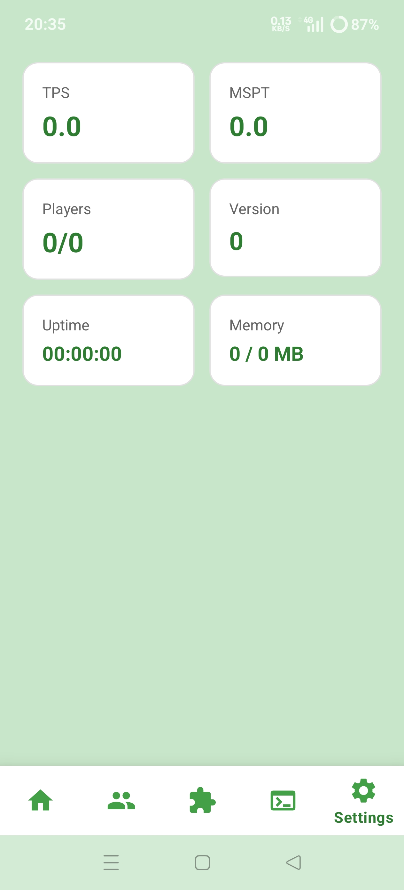
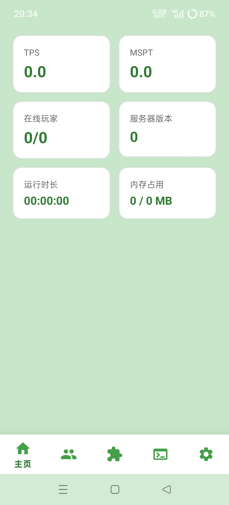

  

  
  
  
  

# XFXZ Mod

一个面向 Minecraft Fabric 26.3 服务端的综合管理模组。本来只是某人想简单做个传送指令，结果越写越多，最后硬生生搓出了一个包含维度管理、AI 对话、原生控制台增强、动态插件系统以及跨平台远程控制面板的完整生态，甚至还配了个 Android 控制端。用起来大概比你直接去后台敲指令要舒服那么一点。

---

## 项目结构

本项目采用了标准的 Gradle 多模块构建，主要为了让你在找文件时不会迷路：

- **xfxzmod**：主模组，负责门面，提供核心指令、控制台增强、AI 聊天、维度传送。
- **xfxzlib**：依赖库模组，打杂的。
- **xfxzPluginLoader**：插件加载器，负责解析、打包并让 Fabric 加载 `.xfxzpe` 插件。
- **plugins/MyThon**：内置的示例插件，用来证明插件系统没白写。
- **plugins/XfPanel**：Web 面板插件，提供 HTTP API 和 WebSocket 服务，专门伺候 Android 客户端。
- **xfxzapp**：Android 控制端，支持状态查看、RCON、玩家管理和插件管理。
- **xfxzcli**：用 Go 写的命令行构建工具，用来拯救每天对着长串 Gradle 命令疯狂复制粘贴的双手。

---

## 服务端命令说明

### 维度传送 (`/xftp`)
将一个或多个玩家传送到指定维度。这大概是整个项目里最正常的指令了。
- **格式**：`/xftp <玩家> <维度ID>`
- **配置文件**：坐标从 `config/xfxz/world_config/<命名空间>/<维度名>.cfg` 读取。
- **默认生成**：首次启动自动生成 `bw2`、`rural`、`main` 三个默认维度，坐标均为 `0 64 0`。
- **智能补全**：带冒号的格式（如 `xfxz:bw2`）直接输入就行，不用去按那个反人类的单引号，支持 Tab 补全。

### AI 聊天接入 (`/ai`)
觉得一个人玩服务器太孤独？现在可以在游戏里直接跟 AI 唠嗑了。
- **格式**：`/ai chat true|false`
- **拦截机制**：开启后，你发的聊天内容会被悄悄拦截并转发给 AI，回复以系统消息返回。每个玩家的开关独立，不会干扰别人。
- **接口配置**：兼容 OpenAI 格式。API URL、Key 和模型名通过 `config/xfxz/ai/ai.cfg` 配置，填上你的本地小模型或者云端大模型就能跑。

### 主管理命令 (`/xfxz`)
服务器综合管理指令，一站式解决各种疑难杂症。
- `/xfxz version`：输出主模组和依赖库的版本号。可以拿来确认自己到底装没装对。
- `/xfxz reload`：重新读取维度、AI 和 OP 配置，并重新扫描插件目录生成插件包。配置即时生效，至于插件？重启服务器才会理你。
- `/xfxz op add|rm|ls <玩家>`：管理模组 OP 权限。新来的玩家默认是卑微的普通人。
- `/xfxz plugins list`：列出已安装插件，直接读取元数据里的 `name` 字段展示。
- `/xfxz plugins add <ID>`：从 GitHub 下载 `<ID>.xfxzpe` 到本地，适合手懒的时候用。
- `/xfxz plugins rm <ID>`：删除指定的插件文件，眼不见为净。

### OP 权限管理系统
- **自动登记**：任何玩家首次进服时，系统都会在 `config/xfxz/user/op.ini` 里给他建个档案，并随机生成一个 24 位的专属 UUID。仪式感拉满。
- **权限控制**：只有被管理员手动赐予 OP 身份的玩家，才能执行 `plugins` 相关的子命令，防止有人乱动你的插件库。

### 控制台增强
受够了原版控制台打字打到一半被后台报错顶飞的痛苦？现在接入了 `TerminalConsoleAppender` 和 `JLine`。我们用 Mixin 强行拦下了原版线程，给你焊死了一个固定在底部的 `>` 提示符。哪怕后台日志像瀑布一样刷屏，你敲了一半的命令也稳如泰山。

---

## 插件系统

- **插件格式**：`.xfxzpe` 披着个陌生的外衣，本质依然是个带有特殊元数据 (`assets/plugin.xfxzjson`) 的 Fabric 模组 jar。
- **动态打包注入**：加载器会在 `preLaunch` 阶段把 `config/xfxz/plugins/` 里选中的插件全扒拉出来，按最高版本打包进 `mods/xfxzplugins.jar`，再借壳上市让 Fabric 加载。不用手动复制改名。
- **依赖声明**：想混进这个圈子，插件内部必须乖乖声明对 `xfxzpluginloader` 的依赖。
- **插件商店与代下载**：App 端接入了商店列表，直接展示远端的最新插件。看中哪个点一下，服务端会自动替你跑腿，把文件拉取并保存到插件目录，省去来回倒腾文件的功夫。

---

## Web 面板 XfPanel

基于 Jetty 11 构建。服务端启动后，它会默默在后台监听 `18923` 端口，首次运行还会生成一个 Token 塞进 `config/xfxz/panel.cfg`，没这串口令谁也别想进。
- `GET /api/status`：返回服务器实时状态，包括 TPS、内存和在线名单。
- `POST /api/rcon`：远程下旨，执行指令并原封不动地把控制台文本输出截获返回，连个 JSON 外壳都不留。
- `GET /api/plugins`：摸清家底，获取已安装插件。
- `POST /api/plugins/download`：服务端化身下载器，支持自动跟随 GitHub 的 302 重定向，无感拉取插件。
- `POST /api/plugins/delete`：一键清理不想要的插件，匹配逻辑连大小写都防住了。
- `/ws`：WebSocket 端点，每 5 秒主动推送一次数据，加入断线自动清理机制，不用担心内存泄漏。

---

## Android 客户端 xfxzapp

用 Java 硬核开发的移动端控制台，让你躺在被窝里也能管服。这版 UI 经过了大幅调整，不仅适配了状态栏，交互也全面向现代 App 靠拢。
- **OOBE 引导与本地记忆**：首次启动一步步教你授权，填好 IP 和 Token 后直接存本地私有目录。下次打开直接跳过引导页，秒进主界面。
- **实时状态**：主页数据通过 WebSocket 实时跳动，沉浸式体验，时刻掌握服务器生死。数据面板采用小方块网格设计，一目了然。
- **玩家管理面板**：独立的玩家 Tab。如果你打开发现空荡荡的，说明服里没人。有人时，每个玩家右侧都有三个点，点开就能直接“踢出”、“给 OP”或“清除 OP”。
- **插件管理面板**：查看已装的插件列表，右侧菜单一键卸载。左上角的按钮唤起插件商店，挑好直接装。
- **RCON 控制台**：内置自定义圆角输入框，敲入指令直接看结果，纯文本回显，干净利落。
- **看门狗监控**：怕服务器卡成 PPT？在设置里开启后，一旦 TPS 或 MSPT 拉胯，App 立刻弹窗并往通知栏丢警告（带 60 秒防抖，不至于把你烦死）。
- **中英双语与自定义时间**：开发者模式隐藏在版本号里，还顺手把语言切换和刷新频率做成了二级菜单，并配有原生质感的自定义弹窗。

**界面演示[中文]**  

**界面演示[English]**  

---

## 构建与开发

### 环境要求
- JDK 25（别用低版本，不然编译报错别怪没提醒）
- Android SDK（编译客户端需要）
- Go 环境（编译 xfxzcli 需要）

### 编译服务端
在项目根目录执行：
`./gradlew build`
产物在 `build/libs/` 下，主模组的 jar 已经把依赖库和加载器像俄罗斯套娃一样打包进去了，直接丢进 `mods` 就能跑。

### 编译 Android 客户端
`cd xfxzapp`
`./gradlew assembleDebug`
Termux 用户请注意，记得把 `android.aapt2FromMavenOverride` 指向系统 aapt2，不然它会给你表演一个架构错误原地崩溃。

---

## 运行环境

- Minecraft 26.3
- Fabric Loader 0.19.5 及以上
- Fabric API
- Java 25
- Android 客户端需要 Android 8.0 及以上

---

## 许可证与作者

- **许可证**：CC BY-NC-SA 4.0。随便用、随便改、随便发，但如果拿它去赚钱，或者改了之后闭源，作者的律师函可能不会到，但良心肯定会痛。详见 LICENSE。
- **作者**：xiaofangii2

## 引用

~~https://github.com/xiaofang/MyThon~~

本项目作者本人的项目，无需引用。
